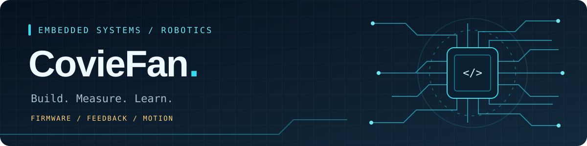

  

<h1 align="center">Hi 👋，我是方世玉 · CovieFan</h1>

  🤖 RoboMaster · 嵌入式开发 · 机器人控制 
  用代码连接现实世界

  
  
  
  

## 🙋 关于我

- 🔭 正在做：机器人云台与电机控制
- 🌱 正在学习：STM32、实时操作系统与控制算法
- 📝 在这里记录项目、实验和学习过程

## 🧭 我的方向

| 方向 | 关注内容 |
| :--- | :--- |
| 🤖 机器人控制 | 云台控制、电机驱动、反馈与调试 |
| 🔌 嵌入式开发 | STM32、外设通信与实时任务 |
| 📓 学习记录 | 从问题出发，用实验验证想法 |

  <a href="https://github.com/CovieFan?tab=repositories">浏览我的项目 →</a>

## 📊 GitHub 足迹

  

  持续学习，持续动手。让每一次提交，都留下解决问题的痕迹。

